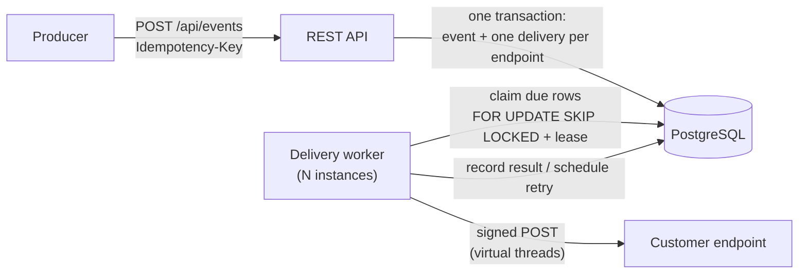
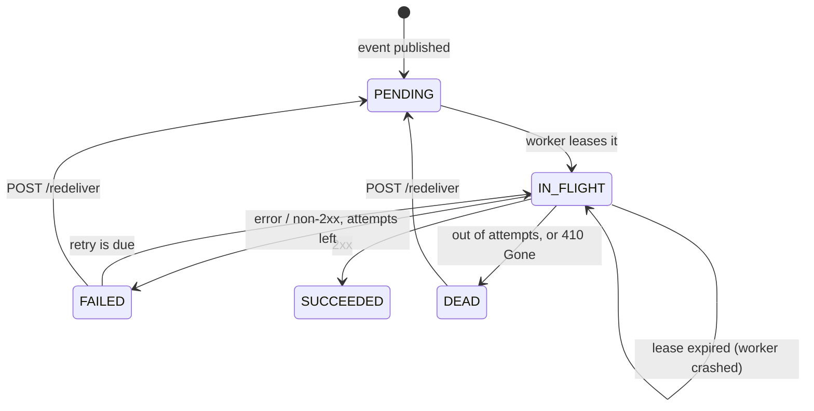

# Hookshot

**A reliable webhook delivery service**: the machinery behind "we'll POST to your URL when something happens", the way Stripe, GitHub and Shopify do it. Built with Spring Boot 3, Java 21 and PostgreSQL.


Sending one HTTP request is easy. Sending it *reliably* is the hard part: receivers go down, networks drop, retries stampede, payloads get forged, and users point webhooks at your internal network. Hookshot is a small, focused implementation of the answers to those problems:

| Problem | How Hookshot handles it |
|---|---|
| Receiver is down or slow | Retries with **exponential backoff + jitter**, then a **dead-letter** state and a manual **redeliver** endpoint |
| Two servers pick up the same job | Postgres queue claimed with **`FOR UPDATE SKIP LOCKED`**; run as many instances as you want |
| A worker crashes mid-send | **Lease-based claiming**: the job becomes visible again when the lease expires (at-least-once delivery) |
| Receiver must trust the sender | **HMAC-SHA256 signatures** with a timestamp (replay protection), Stripe-style header |
| Producer retries a publish call | **Idempotency keys** backed by a unique constraint, including the race between two concurrent requests |
| Users register `http://169.254.169.254/` | **SSRF protection**: scheme allow-list, private/loopback/link-local/CGNAT blocking, no redirects, re-checked at send time |
| "Is it working?" | `/api/stats`, Prometheus metrics, health endpoint |

## Architecture



The `deliveries` table *is* the queue. Publishing an event inserts the event and one delivery row per active endpoint **in a single transaction**, so there is no "saved the event but forgot to enqueue it" failure mode and no separate broker to operate.

### Delivery lifecycle



## Quick start

Requires Java 21, Maven and Docker.

```bash
docker compose up -d db                                   # PostgreSQL
HOOKSHOT_ALLOW_PRIVATE_TARGETS=true mvn spring-boot:run   # the service on :8080
```

(`ALLOW_PRIVATE_TARGETS` lets the demo deliver to `localhost`; leave it `false` in real deployments.)

Or run everything in containers: `docker compose up --build`.

### See it work: retries, backoff and signature verification

```bash
# 1. Register an endpoint. The response contains its signing secret (shown once).
curl -s -X POST localhost:8080/api/endpoints \
  -H 'Content-Type: application/json' -d '{"url":"http://localhost:9000/hook"}'

# 2. Start the demo receiver with that secret. It verifies signatures and
#    simulates an outage by failing the first two requests.
python3 scripts/demo_receiver.py --secret whsec_PASTE_IT_HERE --fail-first 2

# 3. Publish an event (re-running this exact command does NOT send a second webhook).
curl -s -X POST localhost:8080/api/events \
  -H 'Content-Type: application/json' -H 'Idempotency-Key: order-1001' \
  -d '{"type":"order.created","data":{"orderId":1001}}'
```

The receiver prints a `503`, waits for the first retry, prints another `503`, waits for a longer one, then gets a `200`, with every signature reported as `VALID`. Inspect the outcome:

```bash
curl -s localhost:8080/api/deliveries | python3 -m json.tool
curl -s localhost:8080/api/stats
```

## API

| Method | Path | Description |
|---|---|---|
| `POST` | `/api/endpoints` | Register a webhook URL. Returns `201` with the generated signing secret. |
| `POST` | `/api/events` | Publish `{"type": "...", "data": {...}}` and fan out to all active endpoints. `202` for a new event, `200` if the `Idempotency-Key` was already used. |
| `GET` | `/api/deliveries?status=&limit=` | List deliveries, optionally filtered by status. |
| `POST` | `/api/deliveries/{id}/redeliver` | Re-queue a `FAILED` or `DEAD` delivery. `409` if it isn't eligible, `404` if unknown. |
| `GET` | `/api/stats` | Counts per status and the success rate (`succeeded / (succeeded + dead)`). |
| `GET` | `/actuator/health` | Health check for orchestrators. |
| `GET` | `/actuator/prometheus` | Metrics, including `hookshot_delivery_attempts_total{outcome="success\|retry\|dead"}`. |

Errors use RFC 9457 problem responses. Set `HOOKSHOT_API_KEY` to require an `X-API-Key` header on `/api/**`.

### What the receiver gets

```
POST /hook
Content-Type: application/json
X-Hookshot-Signature: t=1700000000,v1=479d263a26872ce2aeda9f217b43b4c9870314fba787aeb383c38d7c7a296e24
X-Hookshot-Event: <event id>
X-Hookshot-Delivery: <delivery id>
X-Hookshot-Attempt: 2

{"id":"<event id>","type":"order.created","data":{"orderId":1001}}
```

To verify: compute `HMAC_SHA256(secret, t + "." + rawBody)`, compare it to `v1` in constant time, and reject timestamps more than a few minutes old. [`scripts/demo_receiver.py`](scripts/demo_receiver.py) is a complete reference implementation. Delivery is **at-least-once**, so receivers should deduplicate on the event or delivery id.

## Design decisions

- **Postgres as the queue, not Kafka/Redis.** Enqueueing in the same transaction as the event removes the dual-write problem, and `SKIP LOCKED` makes Postgres a perfectly good work queue into the thousands of jobs per second. The trade-off is a throughput ceiling and polling latency (about 1s here); the next step up would be `LISTEN/NOTIFY` and then a dedicated broker.
- **Leases instead of "locked_by" columns.** Claiming sets `IN_FLIGHT` and pushes `next_attempt_at` out by the lease length. A crashed worker needs no cleanup job: its rows simply become due again. The cost is that a very slow send can exceed the lease and be sent twice, which is acceptable under at-least-once semantics (and why the receiver should dedupe).
- **Claim in a short transaction, send outside it.** No database connection or row lock is held during HTTP calls. Sends run concurrently on virtual threads.
- **One delivery row per (event, endpoint).** Each endpoint retries independently; one broken receiver never delays the others. A unique constraint prevents duplicate fan-out.
- **Equal-jitter backoff.** `delay ∈ [ceiling/2, ceiling]`, `ceiling = min(1h, 5s · 2^(n-1))`. Some jitter prevents synchronized retry storms; keeping a floor avoids near-zero retries.
- **Idempotency via a unique constraint.** A pre-check serves the fast path; the constraint settles races, and the loser re-reads the winner's event. The failed transaction is rolled back *before* re-querying (a failed statement poisons a Postgres transaction).
- **SSRF checks happen twice**: at registration and again right before sending, and redirects are never followed. Residual risk: DNS can change between the check and the connection (rebinding); pinning the resolved IP is on the roadmap.
- **Plain SQL (`JdbcClient`) over JPA.** The queue's behavior *is* its SQL (locking, leases, ordering), so it stays explicit and reviewable.
- **Injected `Clock`.** All time comes from a `Clock` bean, so tests move time forward to exercise multi-hour backoff schedules instantly.

## Testing

```bash
mvn verify
```

- **Unit tests**: signature vectors (cross-checked against an independent Python HMAC), backoff bounds and capping, SSRF address classification (IPv4/IPv6, metadata, CGNAT), URL validation.
- **End-to-end tests** (`@SpringBootTest` + a real local HTTP server as the customer endpoint): signed delivery, fan-out, retry then dead-letter on a controlled clock, `410` fast-fail, idempotent publish, redelivery, crash-lease recovery, validation errors, SSRF refusal, API-key auth.
- **Concurrency test**: 8 workers race to claim 200 deliveries; every delivery must be claimed exactly once. It needs real PostgreSQL.

Locally the suite runs on in-memory H2 (PostgreSQL mode). CI runs it **twice**: on H2 and against a real PostgreSQL 16 service container, which is where the `SKIP LOCKED` test runs.

## Configuration

| Environment variable | Default | Meaning |
|---|---|---|
| `DATABASE_URL` / `DATABASE_USERNAME` / `DATABASE_PASSWORD` | `jdbc:postgresql://localhost:5432/hookshot` / `hookshot` / `hookshot` | Database connection |
| `HOOKSHOT_API_KEY` | *(empty, auth off)* | Require `X-API-Key` on `/api/**` |
| `HOOKSHOT_ALLOW_PRIVATE_TARGETS` | `false` | Allow localhost/private webhook targets (demos only) |

Tunables in `application.yml` (any can be set as an env var, e.g. `HOOKSHOT_MAX_ATTEMPTS=5`): `hookshot.max-attempts` (8), `base-delay` (5s), `max-delay` (1h), `worker.batch-size` (20), `worker.lease` (60s), `worker.http-timeout` (5s).

## Project layout

```
src/main/java/com/hookshot/
  delivery/   Signatures, BackoffPolicy, AddressPolicy, TargetValidator, WebhookSender, DeliveryWorker
  repo/       JdbcClient repositories (incl. the SKIP LOCKED claim query)
  service/    publish + fan-out transaction, endpoint registration
  web/        REST controllers and error mapping
  config/     typed properties, Clock/Backoff beans, API-key filter
src/main/resources/db/migration/   Flyway schema
src/test/                          unit + end-to-end + concurrency tests
```

## Roadmap

- Pin the resolved IP for each send to close the DNS-rebinding window
- Per-endpoint circuit breaker and rate limiting
- Endpoint management (list, disable, rotate secret) and per-endpoint event-type filters
- `LISTEN/NOTIFY` to cut delivery latency, and a retention job for old deliveries
- Testcontainers so the Postgres tests also run locally with no setup

## License

MIT
